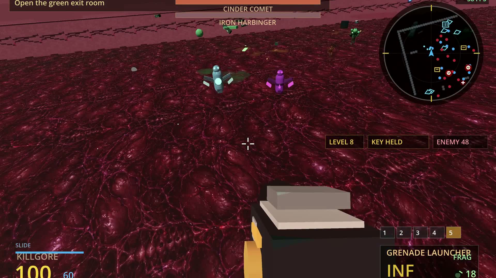

# Killgore

A first-person game prototype built with **Godot 4 and GDScript**, combining fast combat, movement experiments and a flashlight-driven horror chapter.

[Watch an 18-second gameplay clip](media/gameplay-excerpt.mp4) · [Horror creature preview](media/horror-flashlight.png)

## Features

- First-person combat with multiple weapons, enemies, grenades and pickups.
- Sliding, charged jumps and grappling in combat levels.
- Grid-based environments, a TrenchBroom map and experimental levels.
- A horror chapter with a flashlight, battery management, hiding and an animated creature.
- Spatial sound effects, ambience, HUD, level selection and settings.

## Run

1. Open **Godot 4.6.2**.
2. Import this folder's `project.godot` and wait for asset imports.
3. Press **F5**, then choose **Play** or **Level Select**.

**Controls:** WASD to move, mouse to look, left/right click to attack, Space to jump, Shift to slide or sprint, Q to grapple, E to interact, R to reload, G for grenades, Esc to pause. In the horror chapter, F toggles the flashlight.

## Development

I use Codex and other AI tools extensively for implementation and debugging. My role includes creative direction, gameplay and audiovisual decisions, testing, and guiding iterations, alongside some manual code fixes.

The main code is in `scripts/`: player movement, weapons, world logic, creature animation and audio are handled by separate controllers. `assets/` contains game resources; `tools/` contains optional Blender authoring scripts. Blender is not needed to play.

## Current state

This is a work-in-progress prototype. Five headless checks passed, and a local macOS build exported and started successfully in headless mode. A full graphical playthrough and every level/weapon were not tested during portfolio preparation. The clip shows an earlier combat build; the creature image is a staged runtime capture.

This portfolio version uses my legacy weapon visuals. Downloaded 3D weapon models are excluded. See `CREDITS.txt` for other asset credits.
